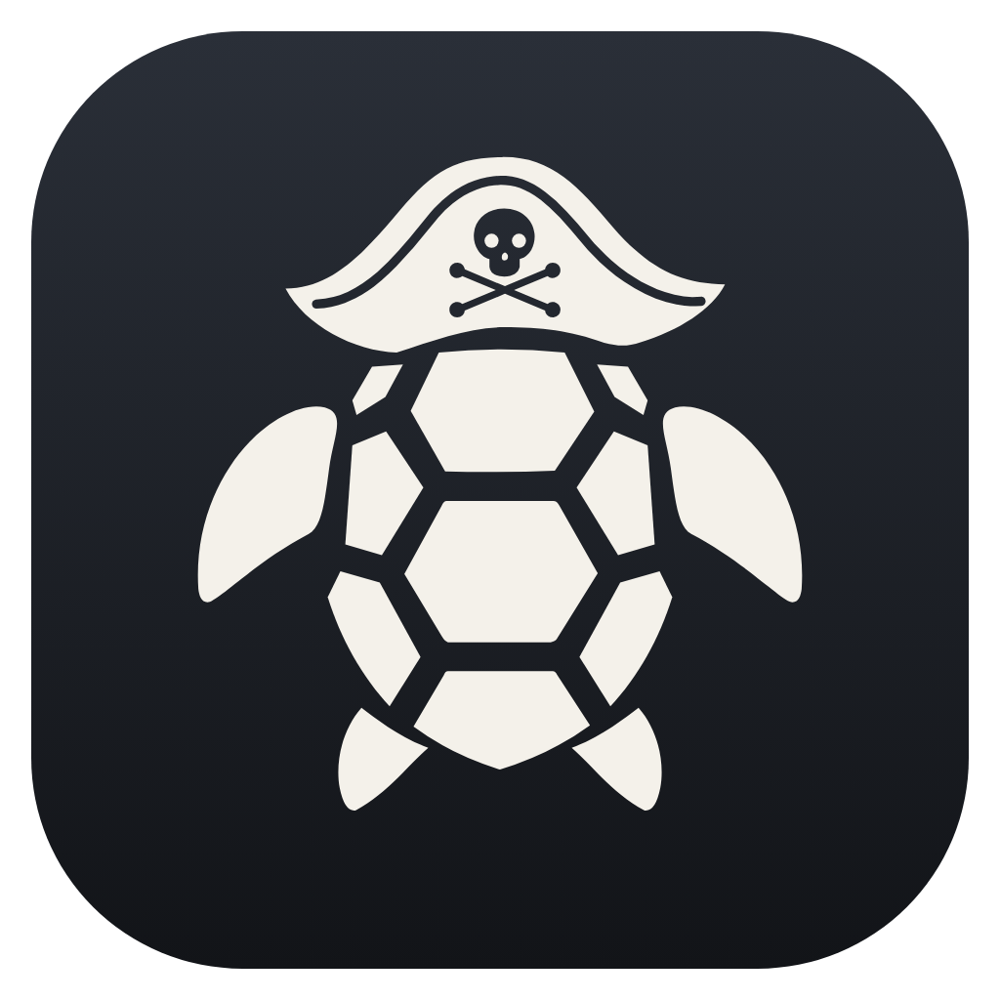
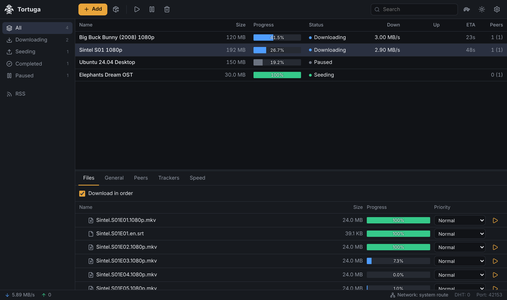
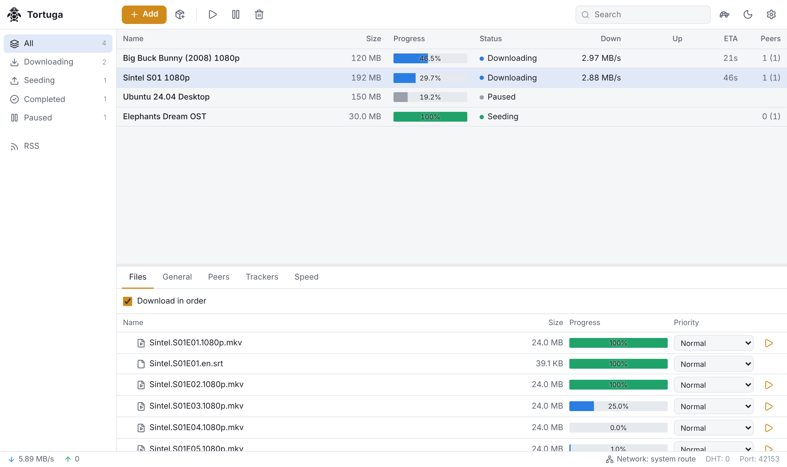

<p align="center"></p>

# Tortuga

A lightweight desktop torrent client for Windows, built with Tauri and Rust
(on top of [librqbit](https://github.com/ikatson/rqbit)).

- **Magnet links and .torrent files.** Tortuga can become the default app for both.
- **Streaming.** Click a video to open it in VLC, mpv, MPC-HC, MPC-BE, PotPlayer or the system player
  while it downloads, or copy the stream link. The pieces the player needs are downloaded first,
  including after seeking.
- **Per-file priorities.** High, Normal, Low or Don't download.
- **Download in order.** Select episodes and download them first, one after another. This turns on
  automatically for torrents with two or more videos.
- **VPN bypass.** Torrent traffic can go around a VPN (split tunnel). In Auto mode it starts like the
  system and bypasses the VPN only when the VPN blocks or throttles P2P.
- **Other features:**
  - RSS auto-download, creating .torrent files, a speed scheduler and turtle mode, tray and
    notifications;
  - fast resume after restart;
  - handling of files deleted manually;
  - dark and light themes;
  - English and Russian (follows the system language).
- **Automatic updates** from GitHub Releases.

<p align="center">
  
</p>

<details>
<summary>Light theme</summary>

<p align="center"></p>
</details>

## Install

Download `Tortuga_x.y.z_x64-setup.exe` from [Releases](../../releases/latest) and run it. No admin
rights are needed. To make Tortuga the default app for magnet links, click *Make default client* in
Settings. Windows then opens its Default apps page with Tortuga preselected.

## Build from source

Requirements:

- Rust (stable);
- Node.js 22;
- on Windows: the WebView2 runtime (preinstalled on Windows 10/11);
- on Linux: `libwebkit2gtk-4.1-dev libayatana-appindicator3-dev librsvg2-dev libxdo-dev`.

```sh
npm ci --prefix ui
npx --prefix ui tauri dev                     # run with hot reload
npx --prefix ui tauri build --bundles nsis    # installer in target/release/bundle/nsis
```

Without the desktop shell, the engine and UI also run as a plain server, which is handy for
development:

```sh
npm run build --prefix ui
cargo run -p tortuga-core --bin tortuga-server -- --ui-dir ui/dist --port 8080
# open the printed http://127.0.0.1:8080/#token=... URL
```

Tests:

```sh
cargo test --workspace
```

## Releases and updates

1. Bump `version` in `src-tauri/tauri.conf.json` and `Cargo.toml`.
2. Push a matching tag:

   ```sh
   git tag v0.2.0 && git push origin v0.2.0
   ```

GitHub Actions then builds the installers and publishes a release. Installed copies check for a newer
release at startup and every 6 hours. They show an *Update* button, which downloads the new
installer and restarts the app.

## Layout

| Path | What |
| --- | --- |
| `crates/tortuga-core` | Engine: torrents, settings, priorities, VPN routing, RSS, scheduler, HTTP API and streaming |
| `src-tauri` | Desktop shell: window, tray, notifications, file associations, players, updates |
| `ui` | React UI |
| `vendor` | Patched `librqbit` (file priorities, in-order download, missing-file handling) and its socket crate (binding to a network adapter on Windows) |
